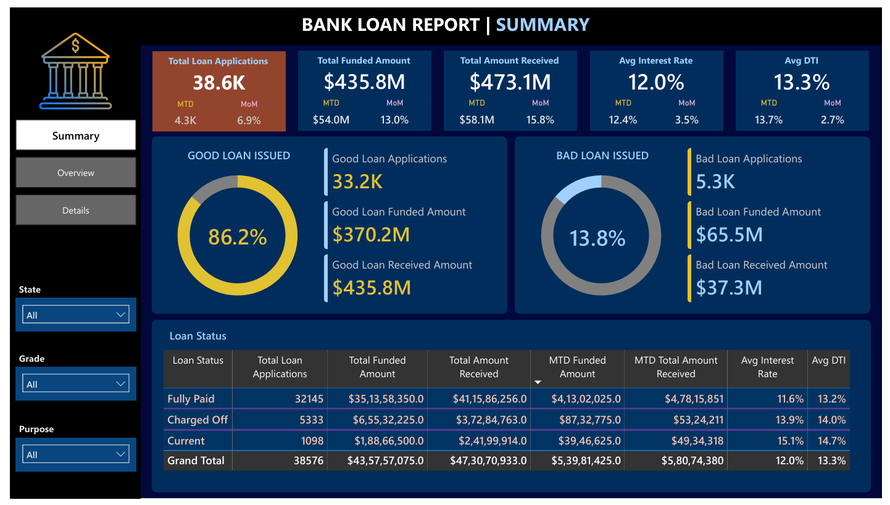
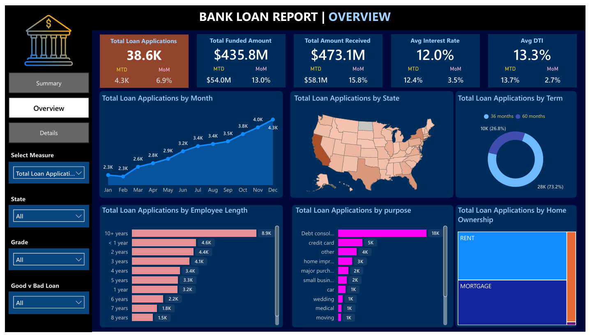
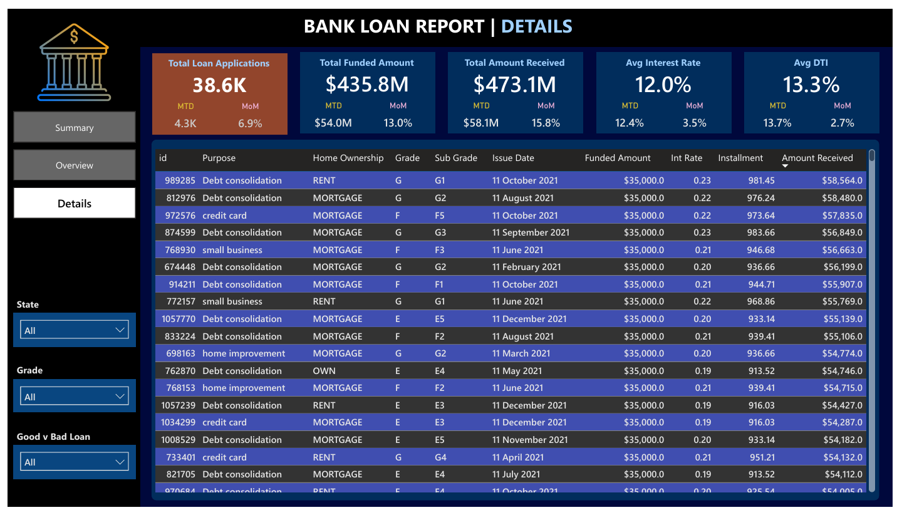

<div align="center">

# 🏦 Bank Loan Analysis Dashboard

### End-to-end loan performance analysis using **SQL Server** and **Power BI**


</div>

---

## 📌 Table of Contents

- [Project Overview](#-project-overview)
- [Problem Statement](#-problem-statement)
- [Tools & Technologies](#-tools--technologies)
- [Dashboard Pages](#-dashboard-pages)
- [Key KPIs](#-key-kpis)
- [Key Insights](#-key-insights)
- [Business Recommendations](#-business-recommendations)
- [Project Structure](#-project-structure)
- [How to Use](#-how-to-use)
- [Author](#-author)

---

## 📖 Project Overview

Banks lend money every day, but not every loan gets repaid. This project analyzes bank loan data to understand **how many loans are given, how much money is funded and received, and which loans are good or bad**.

Data is queried in **SQL Server** and visualized in an interactive **Power BI** dashboard with three pages: **Summary, Overview, and Details**.

---

## ❓ Problem Statement

The bank wants to monitor its lending business and answer questions like:

- How many loan applications are we getting, and is it growing month over month?
- How much money is funded, and how much is actually received back?
- What share of loans are **Good Loans** (Fully Paid / Current) vs **Bad Loans** (Charged Off)?
- Which states, loan purposes, terms, and employment lengths bring the most business?
- Which customer segments carry higher risk (interest rate, DTI)?

---

## 🛠 Tools & Technologies

| Tool | Purpose |
|---|---|
| **SQL Server** | Data storage, querying, KPI calculation |
| **Power BI** | Dashboard design, DAX measures, visuals |
| **DAX** | MTD, MoM and KPI measures |
| **Excel / CSV** | Source data |

---

## 📊 Dashboard Pages

### 1️⃣ Summary
A quick view of the overall health of the loan portfolio with KPI cards and Good vs Bad loan comparison.

<p align="center">
  
</p>

### 2️⃣ Overview
Trends and distribution of loans across months, states, loan term, employee length, purpose, and home ownership.

<p align="center">
  
</p>

### 3️⃣ Details
A detailed table of loan-level data for deep dives and filtering.

<p align="center">
  
</p>

---

## 📈 Key KPIs

| KPI | Meaning |
|---|---|
| **Total Loan Applications** | Number of loan applications received |
| **Total Funded Amount** | Total money given out by the bank |
| **Total Amount Received** | Total money paid back by customers |
| **Average Interest Rate** | Average rate charged on loans |
| **Average DTI** | Average Debt-to-Income ratio of borrowers |
| **MTD / MoM** | Month-to-date values and month-over-month change |

### Good Loan vs Bad Loan

| Type | Loan Status | Meaning |
|---|---|---|
| ✅ **Good Loan** | Fully Paid, Current | Customer is repaying or has repaid |
| ❌ **Bad Loan** | Charged Off | Customer defaulted, bank may lose money |

---

## 💡 Key Insights

> Replace the points below with the real numbers from your dashboard.

- 📌 Loan applications and funded amount show a **[growing / stable]** trend across months.
- 📌 Majority of loans are **Good Loans** (**__%**), while **Bad Loans** are **__%**.
- 📌 Top states by applications: **[State 1, State 2, State 3]**.
- 📌 Most common loan purpose: **[Debt Consolidation / Credit Card / etc.]**.
- 📌 **[36-month / 60-month]** loans are the most popular term.
- 📌 Higher interest rate and higher DTI customers show **more risk**.

---

## ✅ Business Recommendations

| Area | Recommendation |
|---|---|
| Risk control | Check DTI and income carefully before approving high-risk loans |
| Pricing | Set interest rates based on borrower risk segment |
| Growth | Focus marketing on top-performing states and loan purposes |
| Recovery | Follow up early on customers who are late on payments |
| Monitoring | Track Good vs Bad loan % every month using this dashboard |

---

## 📁 Project Structure

```
bank-loan-analysis-dashboard/
│
├── dashboard/        # Power BI dashboard file (.pbix) and PDF
├── data/             # Dataset files (.csv / .xlsx)
├── docs/             # Project documents and presentation
├── images/           # Dashboard screenshots
│   ├── summary.png
│   ├── overview.png
│   └── details.png
├── sql/              # SQL queries used for KPIs and analysis
└── README.md         # Project documentation
```

---

## 🚀 How to Use

1. **Clone the repository**
   ```bash
   git clone https://github.com/your-username/bank-loan-analysis-dashboard.git
   ```
2. Open the **SQL files** from the `sql/` folder in SQL Server to see the queries.
3. Open the **.pbix file** from the `dashboard/` folder in **Power BI Desktop**.
4. Explore the **Summary, Overview, and Details** pages and use the filters.
5. Check the `docs/` folder for project documents and the presentation.

---

## 🎯 Skills Demonstrated

`SQL Queries` • `Data Cleaning` • `DAX Measures` • `KPI Design` • `Data Visualization` • `Business Insights` • `Risk Analysis`

---

## 👤 Author

**Harsh Jairam Yadav**
MCA Graduate | Aspiring Data Analyst | Navi Mumbai, India

[](https://www.linkedin.com/in/your-profile)
[](https://github.com/your-username)

---

<div align="center">

⭐ If you like this project, please give it a star! ⭐

</div>
